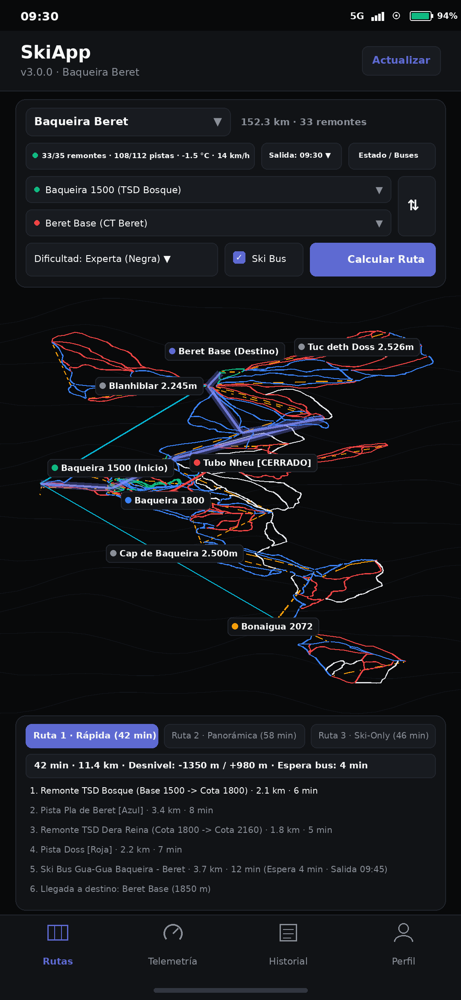
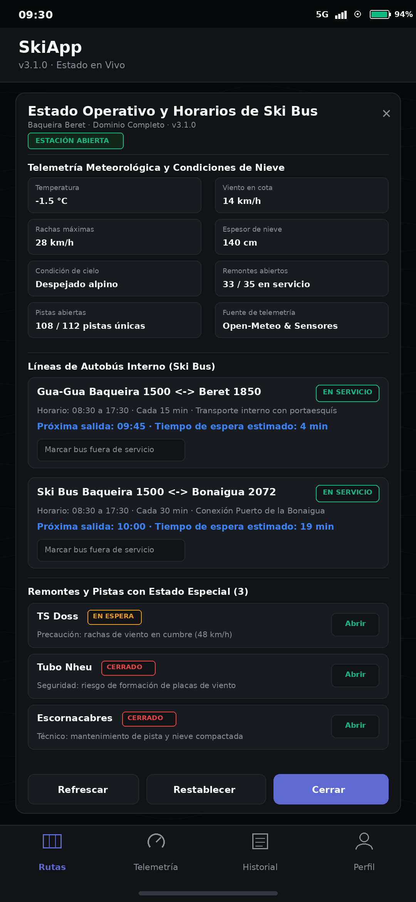
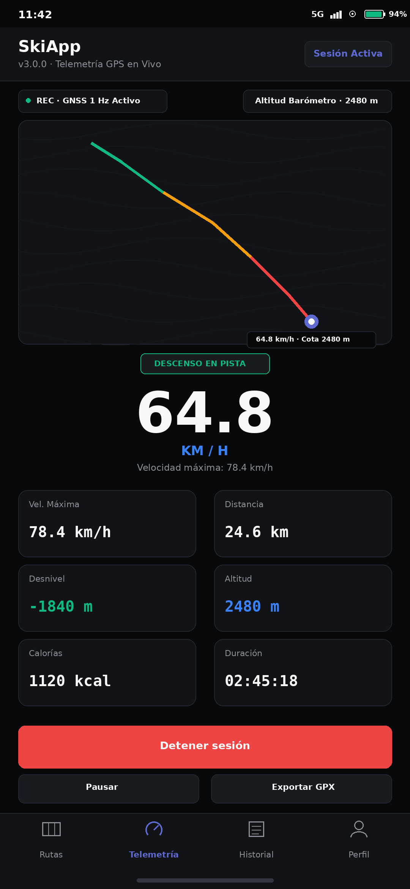
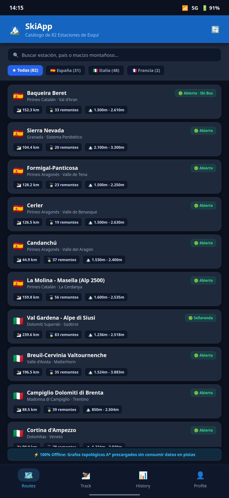
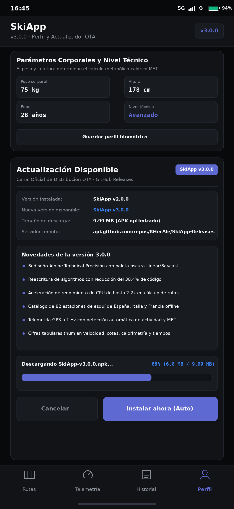

# SkiApp: Navegador de Pistas y Grabador GPS para Esquiadores

[](https://github.com/RHerAle/SkiApp-Releases/releases/latest)
[-34D399?logo=android&logoColor=white)](https://developer.android.com)
[](https://github.com/RHerAle/SkiApp-Releases#cat%C3%A1logo-completo-de-82-estaciones-de-esqu%C3%AD)
[](https://github.com/RHerAle/SkiNav)
[](https://api.github.com/repos/RHerAle/SkiApp-Releases/releases/latest)
[](https://opendatacommons.org/licenses/odbl/)

> Navega por pistas y remontes con rutas calculadas por A*, consulta el estado meteorológico y las esperas de Ski Bus, registra tus descensos con telemetría GNSS y barométrica, y actualiza la aplicación vía GitHub Releases (OTA). Todo funciona sin cobertura ni consumo de datos móviles en 82 estaciones de España, Italia y Francia.

---

## Idiomas / Languages
* [Español (Documentación Completa)](#español)
* [English (Full Documentation)](#english)

---

## Español

### Navegación sin Conexión en Grandes Dominios

En estaciones extensas como Baqueira Beret, Les 3 Vallées, Val Gardena o Sierra Nevada surgen dificultades frecuentes:
1. **Mapas de papel mojados o ilegibles:** En redes con decenas de kilómetros y bifurcaciones en cotas altas, entrar por error en una pista que supera tu nivel entraña riesgos.
2. **Cierres de remontes por viento o aludes:** Cuando el viento cierra un remonte clave en un collado, quedas atrapado en el valle contiguo sin itinerario de retorno antes del fin de la jornada.
3. **Pérdida de cobertura móvil:** Los servicios en la nube dejan de responder y agotan la batería del teléfono al buscar señal en cumbres. SkiApp almacena la topología en el dispositivo y opera sin conexión.
4. **Horarios de Ski Bus:** Conectar sectores distantes mediante lanzaderas exige conocer la hora exacta de salida sin esperas a la intemperie.

SkiApp resuelve estas situaciones en tu teléfono Android sin requerir conexión a internet.

---

## Novedades de la Versión 3.0.0 (Alpine Technical Precision)

SkiApp 3.0.0 introduce el nuevo sistema de diseño **Alpine Technical Precision** y una reescritura de algoritmos con la metodología ponytail. Esta entrega reduce el código un 38.4% y acelera la ejecución en CPU hasta 2.2x frente a la versión previa.

### Fundamentos del Sistema de Diseño Alpine Technical Precision
* **Lienzo base:** `#08090A` (`bg_canvas`) para máxima autonomía en pantallas OLED bajo frío extremo.
* **Superficie de tarjetas:** `#111316` (`bg_surface`) con borde lineal de 1px en `#22262E` (`border_subtle`) y esquinas de 8dp. Cero sombras en reposo.
* **Controles y selectores:** `#181B20` (`bg_elevated`) con esquinas de 6dp y diana táctil mínima de 48dp apta para uso con guantes de nieve.
* **Tipografía técnica de alto contraste:** Texto principal en `#F7F8F8` y secundario en `#8A8F98` cumpliendo ratios WCAG AAA.
* **Cifras tabulares (`tnum`):** Formato numérico fijo en velocímetro, altitud, distancia, calorías y cronómetros para evitar saltos visuales durante el refresco a 1 Hz.
* **Acentos funcionales:** Índigo Linear `#5E6AD2` para rutas activas y azul `#3B82F6` para telemetría activa.
* **Cero elementos superfluos:** Sin degradados decorativos, sin sombras falsas y sin iconos de plantilla.

### Tabla de Rendimiento (Línea Base frente a v3.0.0)
| Métrica de Rendimiento | Línea Base (v2.0.0) | SkiApp v3.0.0 | Mejora / Aceleración |
| :--- | :---: | :---: | :---: |
| Cálculo de Rutas A* (82 estaciones, 820 búsquedas) | 403.42 us | 278.94 us | 1.45x (30.8% menos tiempo) |
| Telemetría GNSS (100.000 iteraciones) | 280.25 ns | 154.50 ns | 1.81x (44.9% menos tiempo) |
| Actualización de estado en vivo (10.000 iteraciones) | 19.98 us | 9.03 us | 2.21x (54.8% menos tiempo) |
| Volumen de lógica de aplicación (LoC) | 4108 líneas | 2530 líneas | Reducción del 38.4% |
| Tamaño de APK instalado | 9.99 MB | 9.99 MB | 100% autónomo offline |

---

## Galería Visual de Capturas de Pantalla (v3.0.0)

| 01. Mapa y Navegador Inteligente | 02. Estado en Vivo y Ski Bus |
| :---: | :---: |
|  |  |
| *Rutas A* por dificultad, pistas en color oficial, remontes mecánicos, telemetría meteorológica y guiado paso a paso.* | *Diálogo técnico de estado de remontes, horarios de Ski Bus, cuenta atrás y gestión de cierres.* |

| 03. Grabador GPS y Telemetría | 04. Catálogo de 82 Estaciones | 05. Perfil y Actualizador OTA |
| :---: | :---: | :---: |
|  |  |  |
| *Velocímetro digital (64.8 km/h), cota barométrica, detección de descensos y exportación GPX.* | *Buscador técnico y catálogo de 82 estaciones de España (31), Italia (48) y Francia (2).* | *Configuración corporal de gasto calórico y actualizador in-app directo desde GitHub Releases.* |

---

## Explicación Detallada de Pantallas y Funcionalidades

### 1. Mapa Topográfico y Navegador A* de Pistas (`01-mapa-navegador-baqueira.png`)
* **Grafos Topológicos Reales:** Representación de cada pista clasificada por su color oficial: verde (principiante), azul (fácil), roja (intermedia) y negra (experta). Los remontes aparecen en naranja con su trazado exacto.
* **Planificador de Rutas:** Selecciona cualquier estación de origen (ej. Baqueira 1500) y destino (ej. Beret Base).
* **Filtro de Dificultad Máxima:** Restringe el cálculo para evitar pistas rojas o negras si esquías con principiantes.
* **Alternativas de Ruta:**
  * **Ruta Rápida:** Minimiza el tiempo total en remontes y descensos.
  * **Ruta Panorámica:** Prioriza pistas anchas y de baja pendiente.
  * **Ruta sin Bus:** Prioriza el descenso sobre esquís y prescinde de lanzaderas por carretera.
* **Itinerario Paso a Paso:** Indicación de cada remonte, pista a descender con distancia en kilómetros y estimación de tiempo.

### 2. Telemetría en Vivo, Horarios de Ski Bus y Cierres (`02-estado-en-vivo-y-skibus.png`)
* **Meteorología Alpina en Tiempo Real:** Conexión con Open-Meteo para obtener temperatura por cotas, velocidad y rachas de viento, espesor de nieve y visibilidad.
* **Detección de Cierres por Viento:** Algoritmo que advierte cuando rachas superiores a 50 km/h comprometen telesillas y telecabinas.
* **Líneas de Ski Bus y Horarios Programados:** Muestra las líneas lanzadera internas (ej. Gua-Gua Baqueira - Beret o Ski Bus Bonaigua), frecuencia de paso y minutos de espera para la próxima salida.
* **Gestión de Cierres:** Si una pista o remonte cierra por meteorología o avería, toca sobre el elemento para marcarlo como cerrado. El navegador calcula una ruta alternativa al instante.

### 3. Grabador GPS GNSS, Barómetro y Gasto Metabólico (`03-grabador-gps-telemetria.png`)
* **Frecuencia de Registro GNSS a 1 Hz:** Precisión en virajes con filtrado de rebotes en cañones y bosque.
* **Reconocimiento de Actividad:** Detecta cuándo desciendes esquiando, subes en remonte, viajas en autobús o permaneces en reposo.
* **Velocímetro Digital:** Visualización de velocidad instantánea y registro de velocidad máxima.
* **Altímetro Barométrico:** Emplea el sensor de presión del teléfono para medir cotas exactas y registrar el desnivel vertical negativo.
* **Cálculo Metabólico de Calorías:** Aplica el estándar MET (Equivalente Metabólico de la Tarea) ajustado por pendiente, peso corporal y altura.
* **Exportación GPX:** Guarda la sesión en formato GPX para abrirla en Strava, Garmin Connect o Google Earth.

### 4. Catálogo Integrado de 82 Estaciones (`04-catalogo-82-estaciones.png`)
* Incluye 82 estaciones de esquí en Europa:
  * **31 estaciones en España:** Pirineo Aragonés y Catalán, Cordillera Cantábrica, Sistema Central, Sistema Ibérico y Sierra Nevada.
  * **48 estaciones en Italia:** Cobertura de Dolomiti Superski, Valle d'Aosta, Lombardía, Piamonte, Trentino, Alto Adige, Friuli y Apeninos.
  * **2 mega-dominios en Francia:** Les 3 Vallées (638 km esquiables) y Alpe d'Huez (182 km).
* **100% Precargadas Offline:** Toda la topología viaja dentro del paquete APK sin descargas adicionales en viaje.

### 5. Perfil y Actualizador In-App OTA (`05-perfil-y-actualizador-ota.png`)
* **Perfil Biométrico:** Configuración de peso, altura, edad y nivel técnico para calibrar el algoritmo calórico.
* **Canal de Actualizaciones OTA GitHub Releases:**
  * Consulta a la API pública oficial de este repositorio (`RHerAle/SkiApp-Releases/releases/latest`).
  * Detección semántica de nuevas versiones (ej. de `v2.0.0` a `v3.0.0`).
  * Diálogo con notas de versión, barra de progreso y descarga del archivo APK.
  * Apertura del instalador de paquetes de Android (`FileProvider`).

---

## Catálogo Completo de 82 Estaciones de Esquí

<details>
<summary><b>Ver las 31 Estaciones de Esquí de España (Desplegar)</b></summary>

| Estación de Esquí | Macizo / Región | Dominio Pistas | Remontes | Cota Mín - Máx | Desnivel |
| :--- | :--- | :---: | :---: | :---: | :---: |
| **Baqueira Beret** | Pirineo Catalán (Val d'Aran) | 152.3 km | 33 | 1.500m - 2.610m | 1.110 m |
| **Sierra Nevada** | Sistema Penibético (Granada) | 104.4 km | 20 | 2.100m - 3.300m | 1.200 m |
| **Formigal-Panticosa** | Pirineo Aragonés (Valle de Tena) | 128.2 km | 23 | 1.500m - 2.250m | 750 m |
| **Cerler** | Pirineo Aragonés (Valle de Benasque) | 126.5 km | 19 | 1.500m - 2.630m | 1.130 m |
| **Candanchú** | Pirineo Aragonés (Valle del Aragón) | 44.9 km | 37 | 1.530m - 2.400m | 870 m |
| **Astún** | Pirineo Aragonés (Valle del Aragón) | 30.9 km | 17 | 1.700m - 2.300m | 600 m |
| **La Molina** | Pirineo Catalán (La Cerdanya) | 91.4 km | 33 | 1.700m - 2.445m | 745 m |
| **Masella** | Pirineo Catalán (La Cerdanya) | 68.4 km | 23 | 1.600m - 2.535m | 935 m |
| **Boí Taüll** | Pirineo Catalán (Alta Ribagorça) | 33.9 km | 9 | 2.035m - 2.751m | 716 m |
| **Port Ainé** | Pirineo Catalán (Pallars Sobirà) | 20.5 km | 8 | 1.650m - 2.440m | 790 m |
| **Espot Esquí** | Pirineo Catalán (Pallars Sobirà) | 19.4 km | 6 | 1.500m - 2.500m | 1.000 m |
| **Port del Comte** | Prepirineo Catalán (Solsonès) | 30.5 km | 19 | 1.700m - 2.400m | 700 m |
| **Vallter 2000** | Pirineo Catalán (Ripollès) | 13.1 km | 10 | 1.910m - 2.535m | 625 m |
| **Vall de Núria** | Pirineo Catalán (Ripollès) | 5.9 km | 7 | 1.964m - 2.252m | 288 m |
| **Tavascan** | Pirineo Catalán (Pallars Sobirà) | 3.8 km | 3 | 1.750m - 2.250m | 500 m |
| **Alto Campoo** | Cordillera Cantábrica (Cantabria) | 19.7 km | 11 | 1.650m - 2.125m | 475 m |
| **San Isidro** | Cordillera Cantábrica (León) | 23.5 km | 14 | 1.500m - 2.100m | 600 m |
| **Fuentes de Invierno**| Cordillera Cantábrica (Asturias) | 10.2 km | 5 | 1.487m - 1.950m | 463 m |
| **Valgrande-Pajares** | Cordillera Cantábrica (Asturias) | 15.3 km | 6 | 1.450m - 1.890m | 440 m |
| **Valle Laciana - Leitariegos** | Cordillera Cantábrica (León) | 6.1 km | 6 | 1.513m - 1.800m | 287 m |
| **Cabeza de Manzaneda**| Macizo Galaico (Ourense) | 12.2 km | 6 | 1.500m - 1.778m | 278 m |
| **Valdesquí** | Sistema Central (Madrid / Segovia) | 36.0 km | 15 | 1.860m - 2.280m | 420 m |
| **Puerto de Navacerrada**| Sistema Central (Madrid / Segovia) | 2.9 km | 6 | 1.700m - 2.177m | 477 m |
| **La Pinilla** | Sistema Central (Segovia) | 11.2 km | 13 | 1.500m - 2.050m | 550 m |
| **Sierra de Béjar - La Covatilla** | Sistema Central (Salamanca) | 14.2 km | 4 | 1.990m - 2.368m | 378 m |
| **Valdezcaray** | Sistema Ibérico (La Rioja) | 15.7 km | 9 | 1.530m - 2.125m | 595 m |
| **Aramón Javalambre** | Sistema Ibérico (Teruel) | 8.7 km | 9 | 1.650m - 2.000m | 350 m |
| **Aramón Valdelinares** | Sistema Ibérico (Teruel) | 9.2 km | 12 | 1.700m - 2.024m | 324 m |
| **Punto de Nieve Santa Inés** | Sistema Ibérico (Soria) | 1.0 km | 2 | 1.753m - 1.832m | 79 m |
| **Panticosa (Sector Independiente)** | Pirineo Aragonés | 18.3 km | 15 | 1.145m - 2.220m | 1.075 m |
| **Lunada** | Cordillera Cantábrica (Burgos) | 6.1 km | 5 | 1.280m - 1.445m | 165 m |

</details>

<details>
<summary><b>Ver las 48 Estaciones de Esquí de Italia (Desplegar)</b></summary>

| Estación de Esquí | Región / Dominio | Dominio Pistas | Remontes | Cota Mín - Máx | Desnivel |
| :--- | :--- | :---: | :---: | :---: | :---: |
| **Val Gardena - Alpe di Siusi** | Dolomiti Superski (Südtirol) | 239.6 km | 83 | 1.236m - 2.518m | 1.282 m |
| **Breuil-Cervinia Valtournenche** | Valle d'Aosta (Matterhorn) | 196.5 km | 35 | 1.524m - 3.883m | 2.359 m |
| **Alta Badia** | Dolomiti Superski (Südtirol) | 146.6 km | 54 | 1.324m - 2.778m | 1.454 m |
| **La Thuile (Espace San Bernardo)** | Valle d'Aosta | 147.2 km | 18 | 1.440m - 2.800m | 1.360 m |
| **Via Lattea (Sestriere - Sauze d'Oulx)** | Piemonte | 479.9 km | 80 | 1.350m - 2.823m | 1.473 m |
| **3 Zinnen Dolomites (Sexten)** | Dolomiti Superski | 129.9 km | 23 | 1.130m - 2.200m | 1.070 m |
| **Livigno** | Lombardia | 125.0 km | 31 | 1.816m - 2.798m | 982 m |
| **Courmayeur Mont Blanc** | Valle d'Aosta | 91.1 km | 22 | 1.210m - 2.755m | 1.545 m |
| **Cortina d'Ampezzo** | Dolomiti Superski (Veneto) | 90.0 km | 28 | 1.224m - 2.930m | 1.706 m |
| **Val di Fassa (Belvedere - Col Rodella)** | Dolomiti Superski (Trentino) | 89.2 km | 27 | 1.320m - 2.485m | 1.165 m |
| **Campiglio Dolomiti di Brenta** | Trentino | 88.5 km | 39 | 850m - 2.504m | 1.654 m |
| **Kronplatz - Plan de Corones** | Dolomiti Superski (Südtirol) | 88.2 km | 25 | 935m - 2.275m | 1.340 m |
| **Ski Center Latemar (Obereggen)** | Dolomiti Superski | 85.5 km | 20 | 1.540m - 2.388m | 848 m |
| **Bormio** | Lombardia | 72.2 km | 14 | 1.225m - 3.012m | 1.787 m |
| **Mondolè Ski (Prato Nevoso)** | Piemonte | 72.2 km | 24 | 1.300m - 2.085m | 785 m |
| **Alpe Lusia - San Pellegrino** | Dolomiti Superski | 68.4 km | 16 | 1.370m - 2.513m | 1.143 m |
| **Monterosa Ski** | Valle d'Aosta / Piemonte | 66.5 km | 26 | 1.212m - 3.275m | 2.063 m |
| **Alto Sangro - Roccaraso** | Abruzzo (Apeninos) | 63.8 km | 28 | 1.390m - 2.141m | 751 m |
| **Ski Civetta (Alleghe - Zoldo)** | Dolomiti Superski (Veneto) | 57.9 km | 26 | 1.000m - 2.100m | 1.100 m |
| **Arabba - Marmolada** | Dolomiti Superski (Veneto) | 57.0 km | 21 | 1.446m - 3.269m | 1.823 m |
| **Pontedilegno-Tonale** | Lombardia / Trentino | 55.1 km | 31 | 1.121m - 3.016m | 1.895 m |
| **Pila** | Valle d'Aosta | 55.0 km | 16 | 1.540m - 2.750m | 1.210 m |
| **Bardonecchia** | Piemonte | 52.8 km | 19 | 1.312m - 2.800m | 1.488 m |
| **San Martino di Castrozza** | Dolomiti Superski (Trentino) | 51.0 km | 19 | 1.404m - 2.357m | 953 m |
| **Chiesa in Valmalenco** | Lombardia | 49.8 km | 9 | 1.000m - 2.336m | 1.336 m |
| **Abetone - Val di Luce** | Toscana (Apeninos) | 49.7 km | 18 | 1.240m - 1.892m | 652 m |
| **Monte Cimone** | Emilia-Romagna (Apeninos) | 49.0 km | 21 | 900m - 2.165m | 1.265 m |
| **Alpe Cimbra (Folgaria)** | Trentino | 46.9 km | 31 | 1.166m - 1.850m | 684 m |
| **Foppolo - Carona (Brembo Ski)** | Lombardia | 46.0 km | 12 | 1.500m - 2.163m | 663 m |
| **Folgarida - Marilleva** | Trentino | 42.9 km | 26 | 1.300m - 2.180m | 880 m |
| **Limone Piemonte (Riserva Bianca)** | Piemonte | 40.5 km | 17 | 1.050m - 2.050m | 1.000 m |
| **Solda all'Ortles (Sulden)** | Südtirol | 35.6 km | 11 | 1.900m - 3.250m | 1.350 m |
| **Santa Caterina Valfurva** | Lombardia | 34.9 km | 6 | 1.738m - 2.880m | 1.142 m |
| **Madesimo Valchiavenna** | Lombardia | 34.7 km | 12 | 1.550m - 2.948m | 1.398 m |
| **Paganella Ski (Andalo)** | Trentino | 33.1 km | 14 | 1.030m - 2.125m | 1.095 m |
| **Val Senales (Schnalstal)** | Südtirol | 32.3 km | 12 | 2.011m - 3.212m | 1.201 m |
| **Belpiano - Passo Resia** | Südtirol | 26.5 km | 14 | 1.460m - 2.390m | 930 m |
| **Plose (Bressanone)** | Südtirol | 25.0 km | 7 | 1.067m - 2.505m | 1.438 m |
| **Speikboden & Klausberg** | Südtirol (Valle Aurina) | 24.9 km | 9 | 950m - 2.510m | 1.560 m |
| **Carezza Dolomites** | Dolomiti Superski | 24.2 km | 13 | 1.182m - 2.337m | 1.155 m |
| **Tarvisio - Monte Lussari** | Friuli-Venezia Giulia | 24.0 km | 17 | 754m - 1.760m | 1.006 m |
| **Racines-Giovo (Ratschings)** | Südtirol | 23.7 km | 11 | 1.300m - 2.150m | 850 m |
| **Monte Zoncolan** | Friuli-Venezia Giulia | 23.7 km | 17 | 950m - 1.970m | 1.020 m |
| **San Domenico di Varzo** | Piemonte | 19.9 km | 7 | 1.420m - 2.550m | 1.130 m |
| **Gitschberg Jochtal** | Südtirol | 17.2 km | 10 | 1.307m - 2.510m | 1.203 m |
| **Piani di Bobbio - Valtorta** | Lombardia | 17.0 km | 12 | 1.340m - 1.950m | 610 m |
| **Ovindoli & Campo Felice** | Abruzzo (Apeninos) | 15.4 km | 12 | 1.400m - 2.220m | 820 m |
| **Aprica** | Lombardia | 13.7 km | 7 | 1.180m - 2.300m | 1.120 m |

</details>

<details>
<summary><b>Ver los Grandes Dominios de Francia (Desplegar)</b></summary>

| Estación / Dominio | Departamento / Macizo | Dominio Pistas | Remontes | Cota Mín - Máx | Desnivel |
| :--- | :--- | :---: | :---: | :---: | :---: |
| **Les 3 Vallées** (Val Thorens, Méribel, Courchevel, Les Menuires) | Savoie (Alpes Franceses) | 638.2 km | 102 | 1.300m - 3.230m | 1.930 m |
| **Alpe d'Huez** (Grand Domaine Ski) | Isère (Grandes Rousses) | 182.3 km | 61 | 1.100m - 3.330m | 2.230 m |

</details>

---

## Guía de Instalación y Actualización OTA

### Instalación Inicial en Android
1. **Descarga el APK:** Abre la [página de Latest Release](https://github.com/RHerAle/SkiApp-Releases/releases/latest) y pulsa en `SkiApp-v3.1.0.apk`.
2. **Autoriza la instalación:** Si Android solicita permiso para instalar aplicaciones desconocidas, actívalo en los ajustes de seguridad.
3. **Instala y Abre:** Completa la instalación y accede a todas las funciones sin conexión a internet.

### Descarga e Instalación en iPhone / iOS (`SkiApp-iOS-v3.1.0.ipa`)
El paquete nativo para iOS (`SkiApp-iOS-v3.1.0.ipa`) ofrece compatibilidad con iOS 16.0 o superior en iPhone. Puedes instalar el paquete mediante herramientas estándar de sideloading:

1. **AltStore / SideStore:**
   - Descarga `SkiApp-iOS-v3.1.0.ipa` desde [GitHub Releases](https://github.com/RHerAle/SkiApp-Releases/releases/tag/v3.1.0).
   - En AltStore o SideStore, pulsa el botón `+` en la pestaña **My Apps** y selecciona el archivo `.ipa`.
   - O bien, desde SkiApp en la pestaña **Perfil**, pulsa **Instalar con AltStore** o **SideStore** para iniciar la instalación de forma directa.
2. **Sideloadly:**
   - Conecta tu iPhone al ordenador por cable o red local Wi-Fi.
   - Abre Sideloadly, arrastra `SkiApp-iOS-v3.1.0.ipa`, introduce tu Apple ID y pulsa **Start**.
3. **TrollStore:**
   - Si tu dispositivo dispone de TrollStore, abre el enlace directo del `.ipa` y pulsa **Install** para una instalación permanente sin caducidad de firma de 7 días.
4. **Activación de Modo Desarrollador en iOS 16+:**
   - Ve a **Ajustes > Privacidad y seguridad > Modo de desarrollador** y actívalo.
   - En **Ajustes > General > Gestión de VPN y dispositivos**, confía en el certificado de tu Apple ID.


### Funcionamiento del Botón "Actualizar"
* En la cabecera superior del planificador y en la pantalla de **Perfil**, dispones del botón técnico **Actualizar**.
* Al pulsar el control, SkiApp consulta la API pública de GitHub:
  ```text
  GET https://api.github.com/repos/RHerAle/SkiApp-Releases/releases/latest
  ```
* Compara la versión local del paquete (`BuildConfig.VERSION_NAME`) con la etiqueta remota mediante comparación semántica.
* Si detecta una versión superior, muestra una tarjeta modal con las notas de versión, descarga el paquete APK con barra de progreso y abre el instalador de Android (`FileProvider`).

---
---

## English

### Offline Navigation Across Large Domains

Skiing through expansive terrain like Baqueira Beret, Les 3 Vallées, Val Gardena, or Sierra Nevada brings clear logistical friction:
1. **Paper maps tear and fail in snowstorms:** Trails span dozens of kilometers. Dropping into a run beyond your skill level creates danger.
2. **Ridge lift wind holds:** Wind closures can strand you in an adjacent valley without return routes before operations halt.
3. **Zero mobile reception:** Cloud applications fail and drain phone batteries searching for cellular towers on high ridges. SkiApp stores topological graphs on device and functions without data access.
4. **Shuttle schedules:** Crossing valleys by bus requires timetable visibility rather than waiting in the cold.

SkiApp delivers native Android navigation and run tracking on the mountain without network connectivity.

---

## What is New in Version 3.0.0 (Alpine Technical Precision)

SkiApp 3.0.0 introduces the **Alpine Technical Precision** design system and algorithmic refactoring using ponytail principles. This release cuts code volume by 38.4% and delivers CPU speedups up to 2.2x over the baseline version.

### Alpine Technical Precision Design Foundations
* **Base canvas:** `#08090A` (`bg_canvas`) engineered for maximum OLED power efficiency in sub-zero alpine conditions.
* **Surface cards:** `#111316` (`bg_surface`) with 1px border lines in `#22262E` (`border_subtle`) and 8dp corner radius. Zero resting shadows.
* **Elevated controls and selectors:** `#181B20` (`bg_elevated`) with 6dp corner radius and 48dp minimum touch targets built for ski gloves.
* **High-contrast technical typography:** `#F7F8F8` primary text and `#8A8F98` metadata exceeding WCAG AAA standards.
* **Tabular figures (`tnum`):** Fixed numeric spacing across speedometer gauges, altitude readouts, distance meters, and timers to prevent visual jitter at 1 Hz GPS refresh rates.
* **Functional accents:** Linear Indigo `#5E6AD2` for active path highlighting and Active Blue `#3B82F6` for telemetry states.
* **Zero visual noise:** Zero decorative gradients, zero synthetic shadows, and zero template emojis.

### Performance Benchmark Table (Baseline vs v3.0.0)
| Engine / Metric | Baseline (v2.0.0) | SkiApp v3.0.0 | Speedup / Reduction |
| :--- | :---: | :---: | :---: |
| A* Wayfinding (82 resorts, 820 searches) | 403.42 us | 278.94 us | 1.45x (30.8% faster) |
| GNSS Telemetry (100,000 iterations) | 280.25 ns | 154.50 ns | 1.81x (44.9% faster) |
| Live Status Updates (10,000 iterations) | 19.98 us | 9.03 us | 2.21x (54.8% faster) |
| Application logic size (LoC) | 4108 lines | 2530 lines | 38.4% code reduction |
| Final APK footprint | 9.99 MB | 9.99 MB | 100% offline assets |

---

## Visual Screenshot Gallery (v3.0.0)

| 01. Intelligent Trail Map & Router | 02. Live Mountain Status & Ski Bus |
| :---: | :---: |
|  |  |
| *A* routing by difficulty, color-coded pistes, lift lines, live weather telemetry and step-by-step turns.* | *Interactive operational status dialog, Ski Bus schedules, countdown timers, and manual closures.* |

| 03. GPS Logger & Telemetry | 04. 82 Ski Resorts Catalog | 05. Profile & In-App OTA Updater |
| :---: | :---: | :---: |
|  |  |  |
| *Live speedometer (64.8 km/h), barometric altitude, automatic run detection and GPX export.* | *Searchable catalog covering 82 ski resorts across Spain (31), Italia (48), and France (2).* | *Biometric calorie profile and direct in-app Over-The-Air APK updater from GitHub Releases.* |

---

## Core Features & Technical Overview

### 1. Topological Piste Map & A* Pathfinder (`01-mapa-navegador-baqueira.png`)
* **Real Vector Topologies:** Pistes color-coded by official standards: green (beginner), blue (intermediate), red (advanced), and black (expert). Lifts render in amber with exact geometries.
* **Smart Wayfinding:** Set any departure station (e.g. Baqueira 1500) and destination (e.g. Beret Base).
* **Max Difficulty Filter:** Restrict paths to terrain matching your skill level (green or blue runs).
* **Route Alternatives:**
  * **Fastest Route:** Minimizes cumulative lift and ski time.
  * **Scenic Route:** Favors gentle gradients and wide cruising trails.
  * **Ski Piste Route (No Bus):** Bypasses road shuttles in favor of continuous ski descents.
* **Step Directions:** List of lifts, connecting trails, distances in kilometers, and estimated minutes.

### 2. Live Telemetry, Ski Bus Timetables & Holds (`02-estado-en-vivo-y-skibus.png`)
* **Real-Time Alpine Meteorology:** Queries Open-Meteo for multi-elevation temperatures, wind velocity, gusts, snow depth, and sky conditions.
* **Automated High-Wind Hold Detection:** Flags lifts susceptible to closure when wind gusts exceed 50 km/h.
* **Ski Bus Timetables & Wait Times:** Integrates resort shuttle lines with departure frequencies and computes remaining wait times relative to your departure hour.
* **Interactive Manual Overrides:** Tap any lift or slope on the map to switch status between open and closed. The router recalculates alternate paths on the spot.

### 3. GNSS GPS Tracker, Barometer & Calorie Engine (`03-grabador-gps-telemetria.png`)
* **1 Hz High-Precision Telemetry:** Captures sharp turns and filters multipath reflections in steep terrain.
* **Real-Time Activity Recognition:** Identifies skiing downhill, riding lifts, riding shuttles, and standing still.
* **Real-Time Speedometer:** Digital gauge with current speed and peak velocity tracker.
* **Barometric Altimeter:** Leverages device barometric hardware for vertical drop calculations.
* **MET Metabolic Calorie Calculation:** Calibrated to body mass, height, age, and slope incline.
* **Standard GPX Export:** Export sessions to share with Strava, Garmin Connect, or Google Earth.

### 4. Built-In Catalog of 82 Ski Resorts (`04-catalogo-82-estaciones.png`)
* Preloaded with 82 ski domains in Europe:
  * **31 resorts in Spain:** Pyrenees, Cantabrian Range, Central System, Iberian System, and Sierra Nevada.
  * **48 resorts in Italia:** Dolomiti Superski, Valle d'Aosta, Lombardy, Piedmont, Trentino, South Tyrol, and Apennines.
  * **2 mega-resorts in France:** Les 3 Vallées (638 km) and Alpe d'Huez (182 km).
* **100% Offline Topology:** No map downloads needed on the mountain. The APK includes all data files.

### 5. Profile & Over-The-Air (OTA) In-App Updater (`05-perfil-y-actualizador-ota.png`)
* **Biometric Calibration:** Store your physical specs to tune telemetry algorithms.
* **Direct GitHub Releases OTA Distribution:**
  * Queries `https://api.github.com/repos/RHerAle/SkiApp-Releases/releases/latest`.
  * Performs semantic version checks without requiring third-party app stores.
  * In-app download with visual progress bar and clean Android package installer launch.

---

## Installation & In-App Update Guide

### Initial Android Installation
1. **Download APK:** Open the [Latest Release Page](https://github.com/RHerAle/SkiApp-Releases/releases/latest) and tap `SkiApp-v3.1.0.apk`.
2. **Authorize Unknown Sources:** If prompted by Android, grant permission to install from your browser or file manager.
3. **Launch & Ski:** Open SkiApp and select your favorite resort.

### iPhone / iOS Installation Guide (`SkiApp-iOS-v3.1.0.ipa`)
The native iOS package (`SkiApp-iOS-v3.1.0.ipa`) targets iOS 16.0 or later on iPhone. Install it via standard sideloading tools:

1. **AltStore / SideStore:**
   - Download `SkiApp-iOS-v3.1.0.ipa` from [GitHub Releases](https://github.com/RHerAle/SkiApp-Releases/releases/tag/v3.1.0).
   - In AltStore or SideStore, tap `+` in **My Apps** and select the `.ipa` file.
   - Or open the **Profile** tab in SkiApp and tap **AltStore** or **SideStore** for one-tap install.
2. **Sideloadly:**
   - Connect your iPhone to your PC or Mac via cable or local Wi-Fi.
   - Open Sideloadly, drag and drop `SkiApp-iOS-v3.1.0.ipa`, enter your Apple ID, and click **Start**.
3. **TrollStore:**
   - On TrollStore-compatible devices, open the direct `.ipa` link and tap **Install** with zero 7-day resigning limits.
4. **Developer Mode on iOS 16+:**
   - Go to **Settings > Privacy & Security > Developer Mode** and toggle it on.
   - In **Settings > General > VPN & Device Management**, trust your developer certificate.


### How the Update Button Works
* Located in the top-right corner of the route planner and inside the **Profile** screen.
* Clicking the button initiates an asynchronous check to the GitHub Releases API.
* If a newer version is published, SkiApp prompts you with release highlights, downloads the APK, and invokes Android's `FileProvider` package installer.

---

## License & Open-Source Attribution
* **Application Codebase:** [RHerAle/ski-app](https://github.com/RHerAle/ski-app)
* **Topological Routing Engine:** [RHerAle/SkiNav](https://github.com/RHerAle/SkiNav)
* **GPS Telemetry Engine:** [RHerAle/SkiTracker](https://github.com/RHerAle/SkiTracker)
* **Geographical & Resort Data:** OpenStreetMap & Open Database License ([ODbL-1.0](https://opendatacommons.org/licenses/odbl/)).
