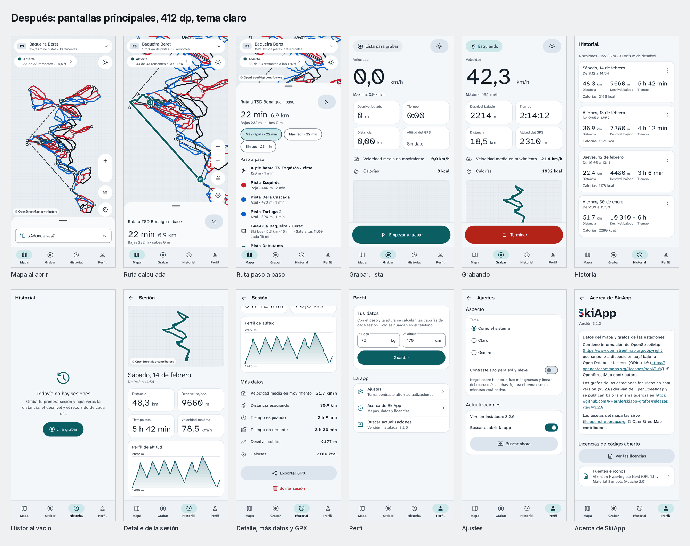
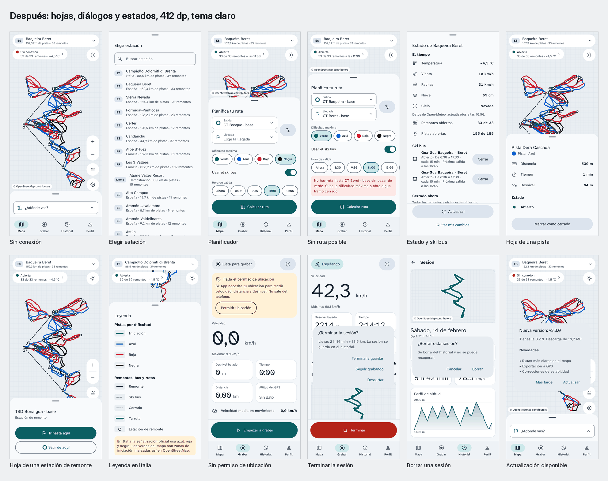
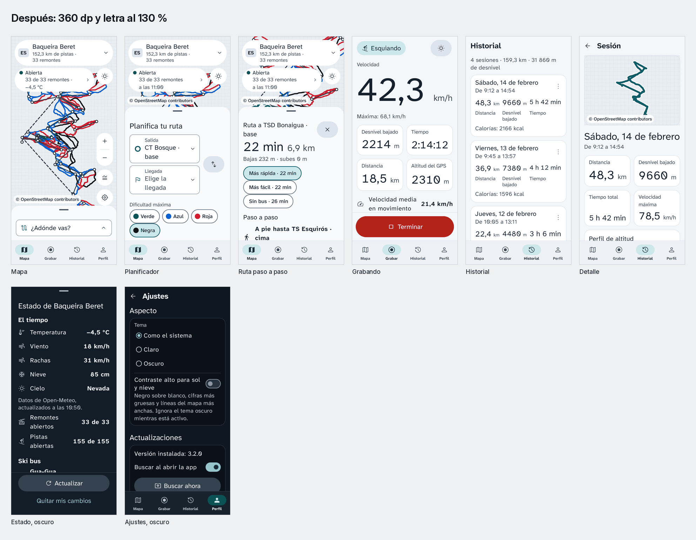
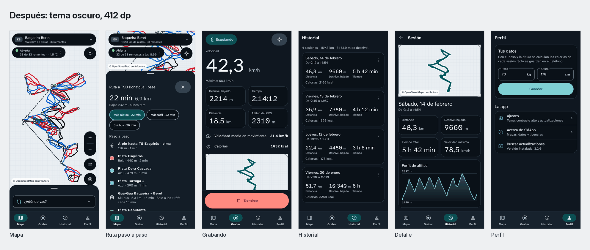
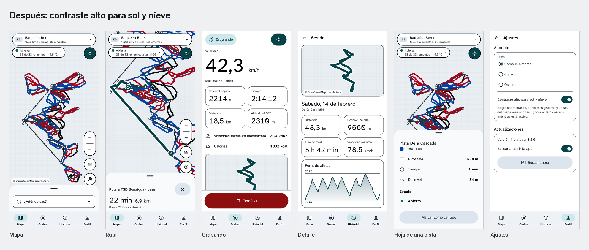

# SkiApp: Navegador de pistas y grabador GPS para esquiadores

[](https://github.com/RHerAle/SkiApp-Releases/releases/tag/v4.1.0)
[-34D399?logo=android&logoColor=white)](https://github.com/RHerAle/SkiApp-Releases/releases/download/v4.1.0/SkiApp-v4.1.0.apk)
[](https://github.com/RHerAle/SkiApp-Releases/releases/download/v4.1.0/SkiApp-iOS-v4.1.0.ipa)
[](https://github.com/RHerAle/SkiApp-Releases#cat%C3%A1logo-completo-de-82-estaciones-de-esqu%C3%AD)
[](https://github.com/RHerAle/SkiNav)
[](https://opendatacommons.org/licenses/odbl/)

> Navega por pistas y remontes con rutas calculadas por A*, consulta el estado meteorológico y las esperas de Ski Bus, registra tus descensos con telemetría GNSS y barométrica, y actualiza la aplicación vía GitHub Releases. Todo funciona sin cobertura ni consumo de datos móviles en 82 estaciones de España, Italia y Francia.

---

## Navegación sin conexión en grandes dominios

En estaciones de esquí de gran extensión como Baqueira Beret, Les 3 Vallées, Val Gardena o Sierra Nevada surgen dificultades frecuentes:
1. **Mapas de papel mojados o deteriorados:** En redes con decenas de kilómetros y bifurcaciones en cotas altas, entrar por error en una pista que supera tu nivel entraña riesgos.
2. **Cierres de remontes por viento o aludes:** Si el viento obliga a detener un remonte clave en un collado, el esquiador puede quedar sin ruta de regreso antes del fin de la jornada.
3. **Falta de cobertura móvil:** Los servicios basados en la nube dejan de responder y agotan la batería del teléfono al buscar señal en cumbres. SkiApp almacena toda la topología en la memoria del dispositivo y opera sin conexión a internet.
4. **Horarios de Ski Bus:** Conectar sectores distantes mediante lanzaderas por carretera exige conocer la hora exacta de salida sin esperas bajo el frío.

SkiApp resuelve estas situaciones en tu teléfono móvil sin requerir conexión de datos.

---

## Novedades de la versión 4.1.0

SkiApp 4.1.0 amplía las capacidades de la plataforma con la incorporación de la nueva pestaña de estaciones con pronóstico meteorológico integrado, detección automática de estación mediante geolocalización, control de pausa y reanudación de sesiones, autorecuperación frente a cierres del sistema y supresión de deriva GPS en reposo.

### Enlaces de descarga oficial

* **Paquete Android:** [SkiApp-v4.1.0.apk](https://github.com/RHerAle/SkiApp-Releases/releases/download/v4.1.0/SkiApp-v4.1.0.apk) (5,47 MB, SHA-256: `e6adba61f9fb27357e4e7c4b65db4af7e2713c75e02f2ae638b6fed84e398e04`)
* **Paquete iOS:** [SkiApp-iOS-v4.1.0.ipa](https://github.com/RHerAle/SkiApp-Releases/releases/download/v4.1.0/SkiApp-iOS-v4.1.0.ipa) (3,06 MB, SHA-256: `f65e40b89d5a932d7f58cf4efe49b6992a8674643bc89ae92f009c7cb8a7a830`)

### Nuevas características de la versión 4.1.0

* **Pestaña Estaciones (5.ª pestaña en la barra inferior):** Catálogo interactivo de las 82 estaciones con pronóstico meteorológico en tiempo real (temperatura, velocidad del viento, rachas y espesor de nieve) obtenido de Open-Meteo, enlace de licencia conforme a sus términos y resumen de remontes abiertos previstos según condiciones meteorológicas y horarios habituales, sin requerir la carga en memoria del grafo completo. Permite ordenar por proximidad al esquiador o alfabéticamente.
* **Detección automática de estación:** Detección de la estación en la que se encuentra el usuario mediante polígonos delimitadores y proximidad a remontes o pistas, cargando automáticamente el dominio esquiable sin necesidad de seleccionarlo a mano.
* **Pausa y reanudación de sesión:** Dos botones táctiles ergonómicos de 72 dp en la pantalla de grabación (Pausar/Reanudar en glaciar y Terminar con contorno suave). La pausa divide la sesión en tramos independientes en la traza y en los ficheros GPX exportados, evitando enlazar paradas con rectas ficticias.
* **Supresión de ruido y deriva GPS en parado (`Acumulador`):** Filtrado que descarta fluctuaciones de señal en reposo para no falsear la distancia ni el desnivel descendido mientras se permanece detenido en pistas o colas.
* **Persistencia y autorecuperación ante cierres del sistema:** Registro periódico en disco que permite restaurar de forma inmediata una sesión en curso en caso de que Android o iOS cierren la app por falta de memoria.
* **Guía técnica de batería y permisos de segundo plano:** Pantalla explicativa con indicaciones específicas para configurar el ahorro de energía en distintos fabricantes y garantizar una grabación continua.
* **Actualización del entorno de compilación:** Migración a Kotlin 2.3.21, Android Gradle Plugin 8.13.2, Gradle 8.14.6, Room 2.8.5 y compilación nativa contra API 36 (Android 16), manteniendo compatibilidad desde Android 8.0 (API 26).

---

### Versión 4.0.0 (Rediseño técnico alpino)

SkiApp 4.0.0 estrenó el sistema de diseño glaciar, tipografía de alta legibilidad, modo de alto contraste para sol y nieve, soporte para actividades en directo en Android e iOS, y exportación de rutas en formato GPX.

#### Pilares del sistema de diseño glaciar

* **Color de marca glaciar (`#0B5F63`):** Tono cromático primario que evoca el hielo alpino. Sobre fondo glaciar, el texto blanco `#FFFFFF` alcanza un ratio de contraste de 7,42:1. En tema oscuro adopta el valor `#7FD0D4`. Este color se distingue con nitidez de las pistas verdes, azules, rojas y negras en todas las variantes de daltonismo.
* **Superficies técnicas y jerarquía visual:** Fondos en superficie `#F4F7FA` (modo claro) y `#0F1720` (modo oscuro), tarjetas de lectura en `#FFFFFF` / `#0A1118`, textos principales en tinta `#15212E` / `#EEF2F6`, y contornos de control en `#6B7788` con separación nítida sin sombras artificiales.
* **Tipografía Atkinson Hyperlegible Next:** Incorporación de esta familia tipográfica creada por el Braille Institute para garantizar una lectura sin confusiones de caracteres bajo frío y vibración. Emplea cifras tabulares (`tnum`) para que velocímetros, altímetros y cronómetros se actualicen a 1 Hz sin oscilaciones de ancho en pantalla.
* **Modo exterior para sol y nieve:** Capa de visualización de máximo contraste diseñada para combatir los reflejos intensos de la nieve bajo sol directo. Aplica fondo blanco puro, textos y contornos en negro `#000000`, pistas con tonos reforzados (`#006B2E`, `#0044A8`, `#B0001B`), ruta en `#064448`, cifras en peso 800 y trazos de mapa con un 50 % extra de grosor. Se activa mediante el botón del sol en el mapa, en la pantalla de grabación o desde Ajustes.
* **Notificaciones en directo en Android 16:** Integración con el estándar `POST_PROMOTED_NOTIFICATIONS`. Mantiene una tarjeta viva en el panel de notificaciones y en la pantalla de bloqueo, junto con un chip en la barra de estado con la insignia de la marca y el cronómetro de sesión. Muestra el estado actual (esquiando, remonte, pausa), cota descendida, distancia y velocidad máxima.
* **Isla dinámica en iOS 16.2+:** Mediante la extensión nativa `SkiAppActividad`, proyecta la sesión en la isla dinámica de iPhone y en la pantalla de bloqueo con tipografía Atkinson y métricas en vivo.
* **Grabador GPS y exportación GPX:** Registro de posición a 1 Hz con filtrado topográfico, discriminación de ascensos y descensos, estimación de gasto metabólico MET según peso y altura, y exportación a ficheros GPX estándar para Strava o Garmin Connect.
* **Pantallas de Ajustes y Acerca de:** Nuevo panel de configuración para seleccionar unidades, alternar temas y activar sensores, junto con la sección Acerca de que detalla la versión, arquitectura y licencias de código abierto.
* **Optimización R8 en Android:** Binario reducido a un único archivo DEX con 5,64 MB de descarga, eliminando código superfluo y agilizando la apertura en frío en procesadores móviles.

---

## Galería visual de capturas de pantalla (v4.0.0)

| 01. Mapa y navegador inteligente | 02. Estado en vivo y Ski Bus |
| :---: | :---: |
|  |  |
| *Rutas A* por dificultad, pistas en color oficial, remontes mecánicos, telemetría meteorológica y guiado paso a paso.* | *Hoja técnica de estado de remontes, horarios de Ski Bus, cuenta atrás y gestión de cierres.* |

| 03. Grabador GPS y telemetría | 04. Catálogo de 82 estaciones | 05. Perfil y actualizador OTA |
| :---: | :---: | :---: |
|  |  |  |
| *Velocímetro digital con cifras tabulares, cota barométrica, detección de descensos y exportación GPX.* | *Buscador técnico y catálogo de 82 estaciones de España (31), Italia (48) y Francia (2).* | *Configuración corporal de gasto calórico y comprobador de versiones desde GitHub Releases.* |

### Hojas de contacto del sistema de diseño glaciar

| Hoja de contacto | Descripción técnica |
| :--- | :--- |
|  | **Pantallas principales:** Mapa topográfico, planificador de ruta, navegación guiada, estado en vivo, grabación de sesión, historial, detalle de descenso, perfil, ajustes y acerca de. |
|  | **Diálogos técnicos:** Selección de estación, selector de dificultad de ruta, gestión de cierres manuales de pistas y remontes, y diálogo modal de actualización OTA. |
|  | **Accesibilidad y pantallas compactas:** Comprobación rigurosa en pantallas de 360 dp de ancho con escala tipográfica al 130 %, asegurando dianas táctiles aptas para guantes. |
|  | **Tema oscuro técnico:** Fondo en `#0F1720` para ahorro de energía en paneles OLED bajo temperaturas gélidas, preservando el contraste cromático de seguridad en pistas. |
|  | **Modo exterior para sol y nieve:** Fondo blanco `#FFFFFF`, trazos en negro `#000000`, ruta en `#064448` y contornos reforzados para anular el deslumbramiento en cumbres nevadas. |

---

## Explicación detallada de pantallas y funcionalidades

### 1. Mapa topográfico y navegador A* de pistas (`01-mapa-navegador-baqueira.png`)
* **Grafos topológicos reales:** Representación de cada pista clasificada por su color normativo: verde (principiante), azul (fácil), roja (intermedia) y negra (experta). Los remontes mecánicos aparecen con su trazado exacto.
* **Planificador de rutas:** Permite escoger una estación de origen (ejemplo: Baqueira 1500) y un destino (ejemplo: Beret Base).
* **Filtro de dificultad máxima:** Restringe el cálculo para omitir pistas rojas o negras si se esquía con personas en fase de iniciación.
* **Alternativas de ruta:**
  * **Ruta rápida:** Reduce la duración total entre remontes y descensos.
  * **Ruta panorámica:** Favorece pistas anchas y de pendiente suave.
  * **Ruta sin bus:** Prioriza el esquí continuo en pista y prescinde de enlaces en autobús.
* **Itinerario paso a paso:** Detalle de cada remonte, pista a descender con distancia en kilómetros y estimación de tiempo de recorrido.

### 2. Telemetría en vivo, horarios de Ski Bus y cierres (`02-estado-en-vivo-y-skibus.png`)
* **Meteorología alpina en tiempo real:** Conexión con Open-Meteo para consultar temperatura por cotas, velocidad y rachas de viento, espesor de manto nivoso y visibilidad.
* **Detección de cierres por viento:** Advertencia automática cuando las rachas superiores a 50 km/h comprometen el funcionamiento de telesillas y telecabinas.
* **Líneas de Ski Bus y horarios programados:** Muestra las líneas lanzadera internas (ejemplo: Gua-Gua Baqueira a Beret o Ski Bus Bonaigua), frecuencia de paso y tiempo restante hasta la siguiente salida.
* **Gestión de cierres:** Al pulsar sobre una pista o remonte cerrado por razones técnicas, el navegador calcula una ruta alternativa en el acto.

### 3. Grabador GPS GNSS, barómetro y gasto calórico (`03-grabador-gps-telemetria.png`)
* **Frecuencia de registro GNSS a 1 Hz:** Alta fidelidad en virajes y curvas con filtrado de rebotes en vaguadas y zonas boscosas.
* **Reconocimiento de actividad:** Detecta si el usuario baja esquiando, sube en remonte mecánico, viaja en autobús o permanece en reposo.
* **Velocímetro digital:** Indicador de velocidad instantánea y registro de velocidad punta alcanzada.
* **Altímetro barométrico:** Utiliza el sensor de presión del dispositivo para registrar la cota exacta y el desnivel vertical negativo acumulado.
* **Cálculo calórico metabólico:** Aplica el estándar MET adaptado a la pendiente, masa corporal y altura del deportista.
* **Exportación en formato GPX:** Almacena la sesión en un archivo GPX para su análisis en Strava, Garmin Connect o Google Earth.

### 4. Catálogo integrado de 82 estaciones (`04-catalogo-82-estaciones.png`)
* Cobertura de 82 dominios esquiables en Europa:
  * **31 estaciones en España:** Pirineo Aragonés y Catalán, Cordillera Cantábrica, Sistema Central, Sistema Ibérico y Sierra Nevada.
  * **48 estaciones en Italia:** Cobertura de Dolomiti Superski, Valle de Aosta, Lombardía, Piamonte, Trentino, Alto Adigio, Friuli y Apeninos.
  * **2 dominios en Francia:** Les 3 Vallées (638 km de pistas) y Alpe d'Huez (182 km).
* **Precarga íntegra sin conexión:** Toda la información topológica viaja en el paquete de instalación, sin requerir descargas adicionales en destino.

### 5. Perfil, Ajustes, Acerca de y actualizador OTA (`05-perfil-y-actualizador-ota.png`)
* **Perfil biométrico:** Configuración de peso, altura, edad y destreza técnica para ajustar el cálculo calórico.
* **Pantalla de Ajustes:** Configuración del tema (claro, oscuro, exterior), preferencias de navegación y parámetros de sensores.
* **Pantalla Acerca de:** Datos de versión, arquitectura técnica, enlaces a repositorios y catálogo de licencias de software y datos.
* **Canal de actualizaciones OTA vía GitHub Releases:**
  * Consulta periódica al canal público oficial (`RHerAle/SkiApp-Releases/releases/latest`).
  * Comparación semántica de versiones entre el paquete local y la versión publicada.
  * Diálogo informativo con notas de versión, barra de descarga y ejecución del instalador del sistema mediante `FileProvider`.

---

## Catálogo completo de 82 estaciones de esquí

<details>
<summary><b>Ver las 31 estaciones de esquí de España (Desplegar)</b></summary>

| Estación de esquí | Macizo o región | Dominio esquiable | Remontes | Cotas (mín - máx) | Desnivel |
| :--- | :--- | :---: | :---: | :---: | :---: |
| **Baqueira Beret** | Pirineo Catalán (Val d'Aran) | 152,3 km | 33 | 1.500 m - 2.610 m | 1.110 m |
| **Sierra Nevada** | Sistema Penibético (Granada) | 104,4 km | 20 | 2.100 m - 3.300 m | 1.200 m |
| **Formigal-Panticosa** | Pirineo Aragonés (Valle de Tena) | 128,2 km | 23 | 1.500 m - 2.250 m | 750 m |
| **Cerler** | Pirineo Aragonés (Valle de Benasque) | 126,5 km | 19 | 1.500 m - 2.630 m | 1.130 m |
| **Candanchú** | Pirineo Aragonés (Valle del Aragón) | 44,9 km | 37 | 1.530 m - 2.400 m | 870 m |
| **Astún** | Pirineo Aragonés (Valle del Aragón) | 30,9 km | 17 | 1.700 m - 2.300 m | 600 m |
| **La Molina** | Pirineo Catalán (La Cerdanya) | 91,4 km | 33 | 1.700 m - 2.445 m | 745 m |
| **Masella** | Pirineo Catalán (La Cerdanya) | 68,4 km | 23 | 1.600 m - 2.535 m | 935 m |
| **Boí Taüll** | Pirineo Catalán (Alta Ribagorça) | 33,9 km | 9 | 2.035 m - 2.751 m | 716 m |
| **Port Ainé** | Pirineo Catalán (Pallars Sobirà) | 20,5 km | 8 | 1.650 m - 2.440 m | 790 m |
| **Espot Esquí** | Pirineo Catalán (Pallars Sobirà) | 19,4 km | 6 | 1.500 m - 2.500 m | 1.000 m |
| **Port del Comte** | Prepirineo Catalán (Solsonès) | 30,5 km | 19 | 1.700 m - 2.400 m | 700 m |
| **Vallter 2000** | Pirineo Catalán (Ripollès) | 13,1 km | 10 | 1.910 m - 2.535 m | 625 m |
| **Vall de Núria** | Pirineo Catalán (Ripollès) | 5,9 km | 7 | 1.964 m - 2.252 m | 288 m |
| **Tavascan** | Pirineo Catalán (Pallars Sobirà) | 3,8 km | 3 | 1.750 m - 2.250 m | 500 m |
| **Alto Campoo** | Cordillera Cantábrica (Cantabria) | 19,7 km | 11 | 1.650 m - 2.125 m | 475 m |
| **San Isidro** | Cordillera Cantábrica (León) | 23,5 km | 14 | 1.500 m - 2.100 m | 600 m |
| **Fuentes de Invierno**| Cordillera Cantábrica (Asturias) | 10,2 km | 5 | 1.487 m - 1.950 m | 463 m |
| **Valgrande-Pajares** | Cordillera Cantábrica (Asturias) | 15,3 km | 6 | 1.450 m - 1.890 m | 440 m |
| **Valle Laciana - Leitariegos** | Cordillera Cantábrica (León) | 6,1 km | 6 | 1.513 m - 1.800 m | 287 m |
| **Cabeza de Manzaneda**| Macizo Galaico (Ourense) | 12,2 km | 6 | 1.500 m - 1.778 m | 278 m |
| **Valdesquí** | Sistema Central (Madrid y Segovia) | 36,0 km | 15 | 1.860 m - 2.280 m | 420 m |
| **Puerto de Navacerrada**| Sistema Central (Madrid y Segovia) | 2,9 km | 6 | 1.700 m - 2.177 m | 477 m |
| **La Pinilla** | Sistema Central (Segovia) | 11,2 km | 13 | 1.500 m - 2.050 m | 550 m |
| **Sierra de Béjar - La Covatilla** | Sistema Central (Salamanca) | 14,2 km | 4 | 1.990 m - 2.368 m | 378 m |
| **Valdezcaray** | Sistema Ibérico (La Rioja) | 15,7 km | 9 | 1.530 m - 2.125 m | 595 m |
| **Aramón Javalambre** | Sistema Ibérico (Teruel) | 8,7 km | 9 | 1.650 m - 2.000 m | 350 m |
| **Aramón Valdelinares** | Sistema Ibérico (Teruel) | 9,2 km | 12 | 1.700 m - 2.024 m | 324 m |
| **Punto de Nieve Santa Inés** | Sistema Ibérico (Soria) | 1,0 km | 2 | 1.753 m - 1.832 m | 79 m |
| **Panticosa (Sector Independiente)** | Pirineo Aragonés | 18,3 km | 15 | 1.145 m - 2.220 m | 1.075 m |
| **Lunada** | Cordillera Cantábrica (Burgos) | 6,1 km | 5 | 1.280 m - 1.445 m | 165 m |

</details>

<details>
<summary><b>Ver las 48 estaciones de esquí de Italia (Desplegar)</b></summary>

| Estación de esquí | Región o dominio | Dominio esquiable | Remontes | Cotas (mín - máx) | Desnivel |
| :--- | :--- | :---: | :---: | :---: | :---: |
| **Val Gardena - Alpe di Siusi** | Dolomiti Superski (Südtirol) | 239,6 km | 83 | 1.236 m - 2.518 m | 1.282 m |
| **Breuil-Cervinia Valtournenche** | Valle de Aosta (Matterhorn) | 196,5 km | 35 | 1.524 m - 3.883 m | 2.359 m |
| **Alta Badia** | Dolomiti Superski (Südtirol) | 146,6 km | 54 | 1.324 m - 2.778 m | 1.454 m |
| **La Thuile (Espace San Bernardo)** | Valle de Aosta | 147,2 km | 18 | 1.440 m - 2.800 m | 1.360 m |
| **Via Lattea (Sestriere - Sauze d'Oulx)** | Piamonte | 479,9 km | 80 | 1.350 m - 2.823 m | 1.473 m |
| **3 Zinnen Dolomites (Sexten)** | Dolomiti Superski | 129,9 km | 23 | 1.130 m - 2.200 m | 1.070 m |
| **Livigno** | Lombardía | 125,0 km | 31 | 1.816 m - 2.798 m | 982 m |
| **Courmayeur Mont Blanc** | Valle de Aosta | 91,1 km | 22 | 1.210 m - 2.755 m | 1.545 m |
| **Cortina d'Ampezzo** | Dolomiti Superski (Véneto) | 90,0 km | 28 | 1.224 m - 2.930 m | 1.706 m |
| **Val di Fassa (Belvedere - Col Rodella)** | Dolomiti Superski (Trentino) | 89,2 km | 27 | 1.320 m - 2.485 m | 1.165 m |
| **Campiglio Dolomiti di Brenta** | Trentino | 88,5 km | 39 | 850 m - 2.504 m | 1.654 m |
| **Kronplatz - Plan de Corones** | Dolomiti Superski (Südtirol) | 88,2 km | 25 | 935 m - 2.275 m | 1.340 m |
| **Ski Center Latemar (Obereggen)** | Dolomiti Superski | 85,5 km | 20 | 1.540 m - 2.388 m | 848 m |
| **Bormio** | Lombardía | 72,2 km | 14 | 1.225 m - 3.012 m | 1.787 m |
| **Mondolè Ski (Prato Nevoso)** | Piamonte | 72,2 km | 24 | 1.300 m - 2.085 m | 785 m |
| **Alpe Lusia - San Pellegrino** | Dolomiti Superski | 68,4 km | 16 | 1.370 m - 2.513 m | 1.143 m |
| **Monterosa Ski** | Valle de Aosta y Piamonte | 66,5 km | 26 | 1.212 m - 3.275 m | 2.063 m |
| **Alto Sangro - Roccaraso** | Abruzos (Apeninos) | 63,8 km | 28 | 1.390 m - 2.141 m | 751 m |
| **Ski Civetta (Alleghe - Zoldo)** | Dolomiti Superski (Véneto) | 57,9 km | 26 | 1.000 m - 2.100 m | 1.100 m |
| **Arabba - Marmolada** | Dolomiti Superski (Véneto) | 57,0 km | 21 | 1.446 m - 3.269 m | 1.823 m |
| **Pontedilegno-Tonale** | Lombardía y Trentino | 55,1 km | 31 | 1.121 m - 3.016 m | 1.895 m |
| **Pila** | Valle de Aosta | 55,0 km | 16 | 1.540 m - 2.750 m | 1.210 m |
| **Bardonecchia** | Piamonte | 52,8 km | 19 | 1.312 m - 2.800 m | 1.488 m |
| **San Martino di Castrozza** | Dolomiti Superski (Trentino) | 51,0 km | 19 | 1.404 m - 2.357 m | 953 m |
| **Chiesa in Valmalenco** | Lombardía | 49,8 km | 9 | 1.000 m - 2.336 m | 1.336 m |
| **Abetone - Val di Luce** | Toscana (Apeninos) | 49,7 km | 18 | 1.240 m - 1.892 m | 652 m |
| **Monte Cimone** | Emilia-Romaña (Apeninos) | 49,0 km | 21 | 900 m - 2.165 m | 1.265 m |
| **Alpe Cimbra (Folgaria)** | Trentino | 46,9 km | 31 | 1.166 m - 1.850 m | 684 m |
| **Foppolo - Carona (Brembo Ski)** | Lombardía | 46,0 km | 12 | 1.500 m - 2.163 m | 663 m |
| **Folgarida - Marilleva** | Trentino | 42,9 km | 26 | 1.300 m - 2.180 m | 880 m |
| **Limone Piemonte (Riserva Bianca)** | Piamonte | 40,5 km | 17 | 1.050 m - 2.050 m | 1.000 m |
| **Solda all'Ortles (Sulden)** | Südtirol | 35,6 km | 11 | 1.900 m - 3.250 m | 1.350 m |
| **Santa Caterina Valfurva** | Lombardía | 34,9 km | 6 | 1.738 m - 2.880 m | 1.142 m |
| **Madesimo Valchiavenna** | Lombardía | 34,7 km | 12 | 1.550 m - 2.948 m | 1.398 m |
| **Paganella Ski (Andalo)** | Trentino | 33,1 km | 14 | 1.030 m - 2.125 m | 1.095 m |
| **Val Senales (Schnalstal)** | Südtirol | 32,3 km | 12 | 2.011 m - 3.212 m | 1.201 m |
| **Belpiano - Passo Resia** | Südtirol | 26,5 km | 14 | 1.460 m - 2.390 m | 930 m |
| **Plose (Bressanone)** | Südtirol | 25,0 km | 7 | 1.067 m - 2.505 m | 1.438 m |
| **Speikboden y Klausberg** | Südtirol (Valle Aurina) | 24,9 km | 9 | 950 m - 2.510 m | 1.560 m |
| **Carezza Dolomites** | Dolomiti Superski | 24,2 km | 13 | 1.182 m - 2.337 m | 1.155 m |
| **Tarvisio - Monte Lussari** | Friuli-Venecia Julia | 24,0 km | 17 | 754 m - 1.760 m | 1.006 m |
| **Racines-Giovo (Ratschings)** | Südtirol | 23,7 km | 11 | 1.300 m - 2.150 m | 850 m |
| **Monte Zoncolan** | Friuli-Venecia Julia | 23,7 km | 17 | 950 m - 1.970 m | 1.020 m |
| **San Domenico di Varzo** | Piamonte | 19,9 km | 7 | 1.420 m - 2.550 m | 1.130 m |
| **Gitschberg Jochtal** | Südtirol | 17,2 km | 10 | 1.307 m - 2.510 m | 1.203 m |
| **Piani di Bobbio - Valtorta** | Lombardía | 17,0 km | 12 | 1.340 m - 1.950 m | 610 m |
| **Ovindoli y Campo Felice** | Abruzos (Apeninos) | 15,4 km | 12 | 1.400 m - 2.220 m | 820 m |
| **Aprica** | Lombardía | 13,7 km | 7 | 1.180 m - 2.300 m | 1.120 m |

</details>

<details>
<summary><b>Ver los grandes dominios de Francia (Desplegar)</b></summary>

| Estación o dominio | Departamento o macizo | Dominio esquiable | Remontes | Cotas (mín - máx) | Desnivel |
| :--- | :--- | :---: | :---: | :---: | :---: |
| **Les 3 Vallées** (Val Thorens, Méribel, Courchevel, Les Menuires) | Saboya (Alpes Franceses) | 638,2 km | 102 | 1.300 m - 3.230 m | 1.930 m |
| **Alpe d'Huez** (Grand Domaine Ski) | Isère (Grandes Rousses) | 182,3 km | 61 | 1.100 m - 3.330 m | 2.230 m |

</details>

---

## Guía de instalación y actualización OTA

### Instalación en Android

1. **Descarga el archivo APK:** Abre el enlace de la [versión v4.0.0](https://github.com/RHerAle/SkiApp-Releases/releases/download/v4.0.0/SkiApp-v4.0.0.apk).
2. **Autoriza orígenes externos:** Si Android solicita confirmación de seguridad para paquetes descargados fuera de la tienda oficial, concede permiso al navegador o administrador de archivos.
3. **Completa la instalación:** Pulsa sobre el archivo para iniciar la aplicación y comenzar la navegación.

### Instalación en iPhone / iOS (`SkiApp-iOS-v4.0.0.ipa`)

El paquete para iOS es compatible con iOS 16.0 o versiones posteriores en iPhone. Puedes cargar el archivo `.ipa` mediante soluciones reconocidas:

1. **AltStore o SideStore:**
   - Descarga el archivo `SkiApp-iOS-v4.0.0.ipa` desde [GitHub Releases](https://github.com/RHerAle/SkiApp-Releases/releases/download/v4.0.0/SkiApp-iOS-v4.0.0.ipa).
   - En la aplicación AltStore o SideStore, pulsa el botón `+` en la pestaña de aplicaciones y selecciona el fichero `.ipa`.
2. **TrollStore:**
   - En terminales compatibles con TrollStore, descarga el archivo e instálalo para un uso continuado sin caducidad de firma de 7 días.
3. **Modo desarrollador en iOS 16+:**
   - Accede a **Ajustes > Privacidad y seguridad > Modo de desarrollador** y actívalo en el terminal.
   - En **Ajustes > General > Gestión de VPN y dispositivos**, valida el perfil asociado a tu cuenta.

### Funcionamiento de la actualización OTA

* En la esquina superior del planificador y en la pantalla de **Perfil**, dispones del control técnico de comprobación.
* Al pulsar el botón, la aplicación contacta con el servicio de versiones de GitHub:
  ```text
  GET https://api.github.com/repos/RHerAle/SkiApp-Releases/releases/latest
  ```
* Analiza los componentes numéricos de la etiqueta de release frente a la versión en ejecución.
* Si existe una entrega posterior, presenta un diálogo con los cambios destacados, descarga el paquete APK mostrando la progresión y activa el instalador del sistema a través de `FileProvider`.

---

## Licencias y atribución de código abierto

* **Código fuente de la aplicación:** [RHerAle/ski-app](https://github.com/RHerAle/ski-app)
* **Motor de navegación topológica:** [RHerAle/SkiNav](https://github.com/RHerAle/SkiNav)
* **Motor de telemetría y registro GPS:** [RHerAle/SkiTracker](https://github.com/RHerAle/SkiTracker)
* **Datos cartográficos y de estaciones:** OpenStreetMap y Open Database License ([ODbL-1.0](https://opendatacommons.org/licenses/odbl/)).
